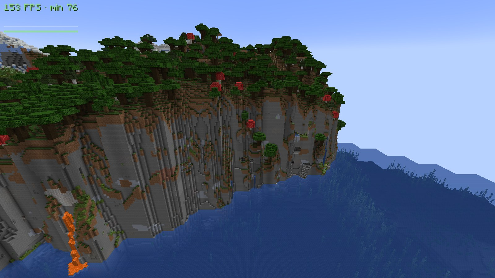
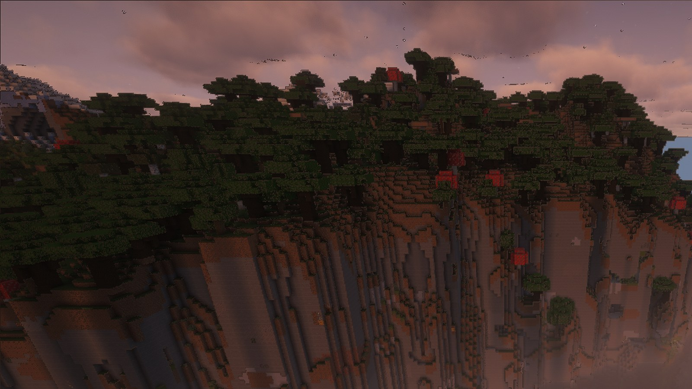
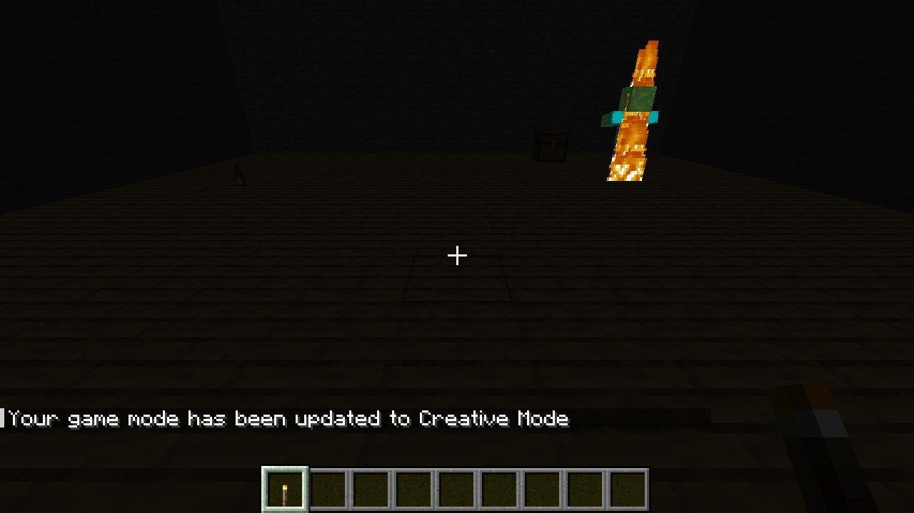
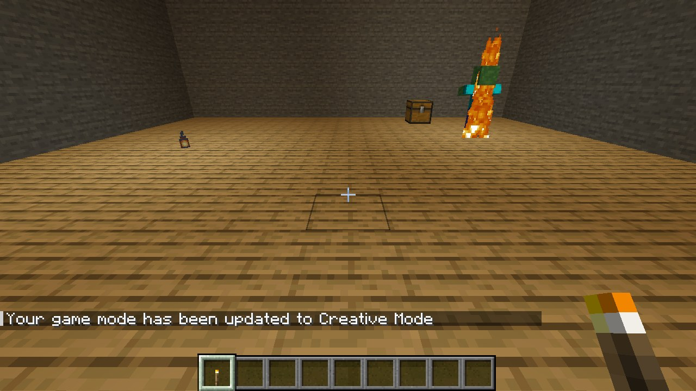
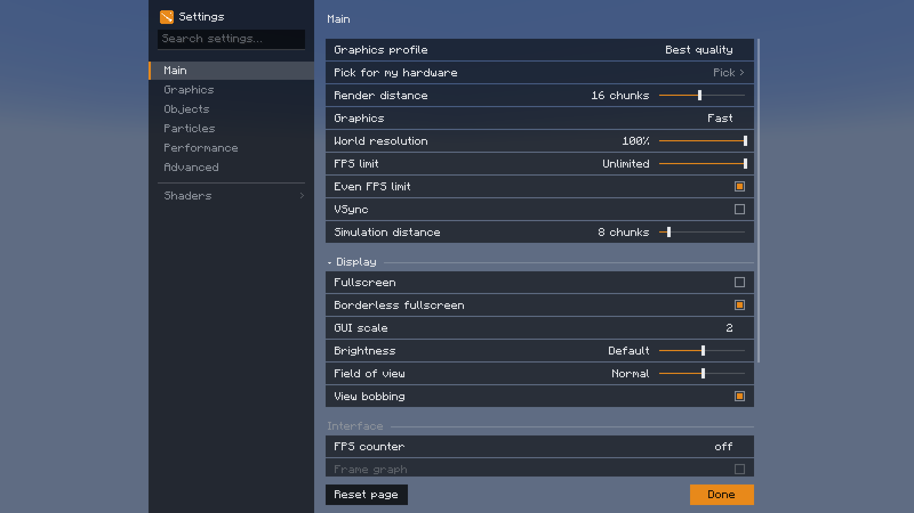
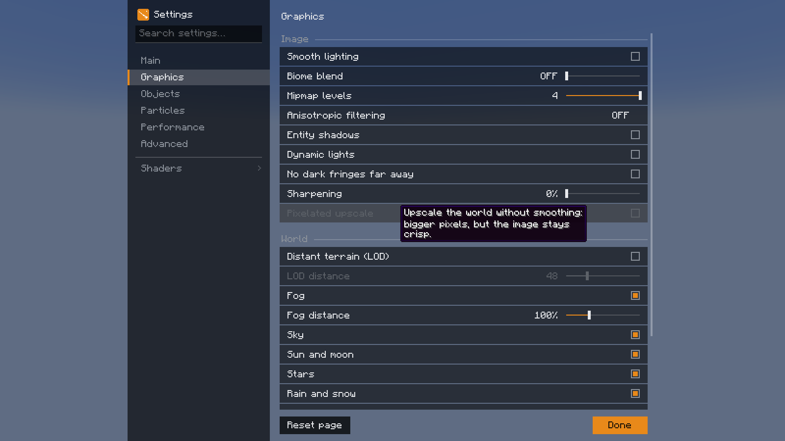
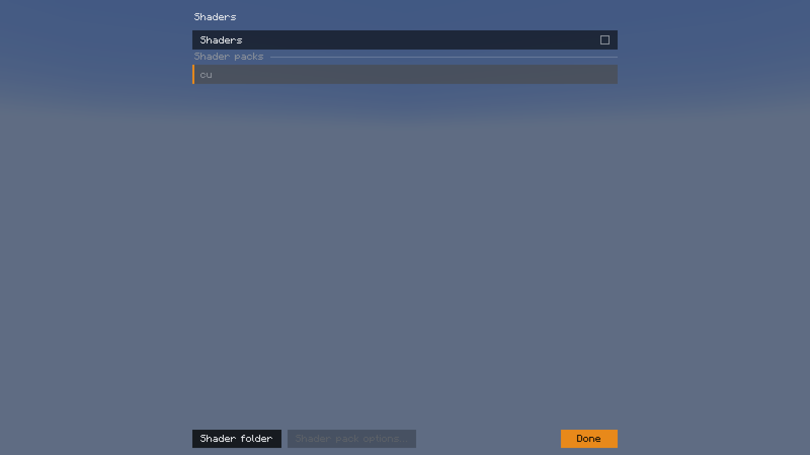

# Nimbus

**One optimization mod for Minecraft 1.21.1 (Fabric) instead of a dozen.** Nimbus brings its own terrain renderer,
a shader pack loader that works without Iris, Lithium-style server optimizations and a set of memory and loading
fixes. It runs on the client and on dedicated servers.

Out of the box Nimbus changes nothing you can see — it only raises the frame rate. Anything that trades looks for
speed (lower resolution, shorter distances, fewer effects) is opt-in through a graphics profile or the settings.



## What it replaces

Sodium · Lithium · FerriteCore · ModernFix · ImmediatelyFast · Entity Culling · More Culling · Enhanced Block
Entities · Dynamic FPS · FastQuit · RRLS · Cubes Without Borders · LambDynamicLights — and, for shader packs, Iris.

If one of those mods is installed anyway, the matching part of Nimbus steps aside on its own: with Sodium the terrain
renderer yields (and with Sodium + Iris, Iris runs the shader packs), with Lithium the server optimizations switch
off, and so on.

## Features

**Terrain renderer.** GPU-driven drawing with per-draw frustum culling on the GPU, so turning the camera never rebuilds
draw lists on the CPU. Hi-Z occlusion culling drops chunks hidden behind hills and buildings before they are drawn and
pauses itself where it would not pay off. Visible-section search runs on a worker thread; translucent geometry is
sorted incrementally. Optional distant terrain (LOD) beyond the render distance.

**Entities, particles, interface.** Instanced mob and particle rendering, cached HUD and item icons, simplified signs
and chests in the distance, per-type culling distances.

**Shader packs.** Its own loader for OptiFine/Iris-format packs — Complementary, BSL, Photon, Mellow, Sildur's — with
pack options and Iris-style keys (R reload, K toggle, O shader screen).



**Server and singleplayer.** A full port of Lithium's optimizations in Nimbus' own code: collisions, mob AI and
pathfinding, hoppers and furnaces, scheduled ticks, explosions, pistons, chunk palettes and saving. On our server
scenes Nimbus matches or beats Lithium. Where the result can be compared, patches are checked against vanilla
(block and entity collisions, fluids, hopper contents bit for bit, explosion exposure, tick order).

**Memory and loading.** Shared block shapes and models, lazy GPU buffers and search trees — heap use close to
FerriteCore + ModernFix. Resource reloads without the loading screen, instant world exit.

**Quality of life.** Precise frame limiter, screenshots without a hitch, FPS counter with a frame-time graph,
anisotropic filtering, CAS sharpening, render resolution scaling, smooth chunk fade-in, dynamic lights (a torch in
hand, burning mobs, dropped lanterns), and F8 to collect a bug report in one archive.

| Dynamic lights off | Dynamic lights on |
|---|---|
|  |  |

## Settings

A Sodium-style settings screen with search, dependent options that dim instead of disappearing, and a separate
shader screen.

| Main | Graphics | Shaders |
|---|---|---|
|  |  |  |

Graphics profiles, plus a **Pick for my hardware** button that looks at the GPU and the screen and errs on the safe
side:

| Profile | For | Changes |
|---|---|---|
| Best quality | strong PCs | everything high, LOD 64, 16× anisotropy, dynamic lights |
| Balanced | most players | full resolution, detailed graphics, small things simplified in the distance |
| Performance | laptops, integrated graphics | 75% resolution with sharpening, LOD 32, 2 mipmap levels |
| Max FPS | very weak PCs | 50% resolution, everything optional turned off |

## Benchmark

Laptop with integrated AMD Vega 8 graphics, 1280×720, 20 s per scene, Nimbus 4.0.3 against Sodium 0.8.13.

| Scene | Sodium FPS | Nimbus FPS | Sodium 1% low | Nimbus 1% low |
|---|---|---|---|---|
| terrain | 108 | 158 | 36 | 38 |
| flight | 69 | 110 | 17 | 26 |
| forest | 122 | 162 | 33 | 58 |
| blocks | 145 | 184 | 40 | 49 |
| hill | 105 | 166 | 27 | 42 |
| water | 116 | 144 | 24 | 47 |
| biomes | 112 | 142 | 30 | 45 |
| mobs | 42 | 59 | 6 | 8 |
| particles | 77 | 104 | 10 | 24 |
| inventory | 118 | 143 | 25 | 33 |
| far | 36 | 79 | 7 | 26 |

## Compatibility

Tested together with Continuity, Polytone, Entity Texture/Model Features, CIT Resewn, Animatica, FabricSkyboxes,
OptiGUI, LambDynamicLights, Xaero's maps, JEI, VanillaBackport and Wurst. Resource packs that rely on Continuity
(e.g. Fast Better Grass) render the same as on Sodium.

## Installation

Requires Minecraft 1.21.1, Fabric Loader 0.16 or newer, Fabric API and Java 21. Drop the jar into `mods`. The same jar
works on a dedicated server, where only the server-side optimizations load.

## Building

```
./gradlew build
```

The jar ends up in `build/libs`.

## Changelog

- **4.0.3** — Hi-Z occlusion culling on by default, combined with GPU frustum culling and self-pausing in open views;
  smooth chunk fade-in; dynamic lights; "Pick for my hardware"; faster scheduled ticks, piston shapes and explosion
  exposure; 30 MB less heap; async screenshots, precise frame limiter, frame graph, anisotropic filtering, Iris-style
  shader keys, new settings screen and a dedicated shader screen.
- **4.0.2** — defaults change nothing visible, reworked profiles, upscaling and sharpening in one pass, resource
  reloads without the loading screen, 26 MB less heap.
- **4.0.1** — instant world exit, mipmap fill without Sodium, Nether lighting fixes, 30 MB less heap.
- **4.0.0** — own shader pack loader.
- **3.0.x** — Lithium port: server and singleplayer optimizations, client light healing.
- **2.x** — own terrain renderer, instanced mobs and particles, LOD, HUD cache, F8 bug reports.
- **1.x** — first optimizations on top of vanilla rendering.

## License

All rights reserved.
